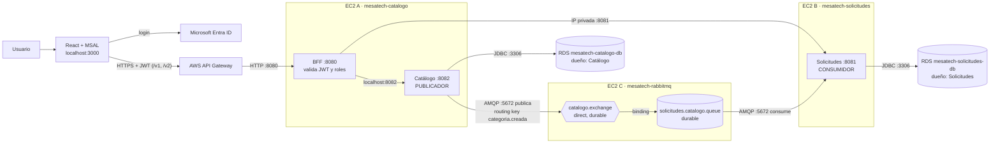

# MesaTech Cloud: EP2, mensajería y persistencia independiente

DSY1107 Desarrollo Cloud Native I. Este proyecto continúa la EP1.

En la EP2, **Catálogo** guarda cada categoría en su propio RDS y publica un evento en RabbitMQ.
**Solicitudes** consume ese evento y guarda una copia de la categoría en *su* propio RDS. Esa copia es
la que se usa al registrar solicitudes. Solicitudes nunca consulta la base de datos de Catálogo.

| Documento | Contenido |
|---|---|
| Este README | Arquitectura, versiones, compilación, variables, arranque y detención, contrato del evento y endpoints |
| [docs/GUIA_DESPLIEGUE_AWS_ACADEMY.md](docs/GUIA_DESPLIEGUE_AWS_ACADEMY.md) | Despliegue paso a paso desde cero: RDS, EC2, security groups, Docker, RabbitMQ y API Gateway |
| [docs/PRUEBAS_Y_DEMO.md](docs/PRUEBAS_Y_DEMO.md) | Pruebas P1 a P8 con los comandos de cada una, guion de la demo y preguntas de defensa |

---

## 1. Arquitectura de despliegue



| Componente | Ubicación | Responsabilidad |
|---|---|---|
| Catálogo (publicador) | EC2 A | Mantiene categorías y prioridades, guarda en RDS Catálogo y publica `CATEGORIA_CREADA` |
| BFF | EC2 A (permitido por la pauta) | Valida el JWT de Entra ID, autoriza por rol y coordina las llamadas (EP1) |
| Solicitudes (consumidor) | EC2 B | Mantiene las solicitudes y sus estados, consume el evento y guarda la copia en `categorias_recibidas` |
| RabbitMQ 4.2 | EC2 C, con Docker Compose | Broker con virtual host `mesatech` |
| RDS Catálogo | Instancia `mesatech-catalogo-db` | Base `mesatech_catalogo`, usuario `catalogo_app` |
| RDS Solicitudes | Instancia `mesatech-solicitudes-db` | Base `mesatech_solicitudes`, usuario `solicitudes_app` |

**Flujos que implementa el proyecto:**
1. React → API Gateway → BFF → Catálogo → RDS Catálogo
2. Catálogo → `catalogo.exchange` → `solicitudes.catalogo.queue` → consumidor de Solicitudes → RDS Solicitudes
3. React → API Gateway → BFF → Solicitudes → categorías locales y registro de la solicitud en RDS Solicitudes

---

## 2. Versiones

| Componente | Versión |
|---|---|
| Java (compilación) | `release 17` (pom.xml) |
| Java (ejecución en las EC2) | OpenJDK 21 (`openjdk-21-jre-headless`, Ubuntu 24.04) |
| Spring Boot | 4.1.1 |
| Spring AMQP | 4.1.1 (`spring-boot-starter-amqp`), JSON con Jackson 3 (`JacksonJsonMessageConverter`) |
| MySQL en RDS | 8.4 (driver `com.mysql:mysql-connector-j`, puerto 3306) |
| Docker Engine y plugin Compose | Últimas versiones estables del repositorio oficial de Docker. Registrar `docker --version` y `docker compose version` |
| RabbitMQ | Imagen oficial `rabbitmq:4.2-management` |
| SO de las EC2 | Ubuntu Server 24.04 LTS |
| Frontend | React 19, MSAL Browser 5, Axios, Bootstrap 5 |

---

## 3. Estructura del repositorio

```
backend/
  backend-springboot-jwt/        BFF (Spring Security, OAuth2 Resource Server)
  microservicio-catalogo/        Catálogo: publicador (paquete mensajeria/)
  microservicio-solicitudes/     Solicitudes: consumidor (paquete mensajeria/)
frontend/dfs-s3-login-1/         React + MSAL
infra/
  rabbitmq/compose.yaml          Broker (EC2 C)
  rabbitmq/.env.example          Credenciales ficticias (el .env real no se sube)
  rabbitmq/configurar-recursos.sh  Virtual host, usuarios, permisos, exchange, cola y binding
  rds/01_catalogo.sql            Base, usuario y tablas de RDS Catálogo
  rds/02_solicitudes.sql         Base, usuario y tablas de RDS Solicitudes
  rds/03_consultas_evidencia.sql Consultas para las evidencias
  systemd/*.service              Servicios Linux para los .jar
docs/                            Guía de despliegue, pruebas y demo
```

---

## 4. Compilación

Requisitos: JDK 17 o superior. Cada servicio incluye Maven Wrapper.

```bash
cd backend/microservicio-catalogo    && ./mvnw clean package   # target/microservicio-catalogo-0.0.1-SNAPSHOT.jar
cd backend/microservicio-solicitudes && ./mvnw clean package   # target/microservicio-solicitudes-0.0.1-SNAPSHOT.jar
cd backend/backend-springboot-jwt    && ./mvnw clean package   # target/api-cloud-native-0.0.1-SNAPSHOT.jar
```

En Windows se usa `mvnw.cmd clean package`. Las pruebas usan H2 en memoria y no necesitan RabbitMQ.

Frontend:
```bash
cd frontend/dfs-s3-login-1
cp .env.example .env        # completar con la URL de API Gateway
npm install
npm start                   # http://localhost:3000 (URI de redirección registrada en Entra ID)
```

---

## 5. Variables de entorno

Ningún archivo del repositorio contiene contraseñas. En cada EC2, las variables reales van en
`/etc/mesatech/<servicio>.env` con permisos `600`, y las carga el servicio systemd.

| Servicio | Archivo de ejemplo | Variables |
|---|---|---|
| Catálogo (EC2 A) | `backend/microservicio-catalogo/.env.example` | `DB_URL`, `DB_USERNAME`, `DB_PASSWORD`, `RABBITMQ_HOST`, `RABBITMQ_PORT`, `RABBITMQ_VHOST`, `RABBITMQ_USERNAME`, `RABBITMQ_PASSWORD`, `RABBITMQ_EXCHANGE`, `RABBITMQ_ROUTING_KEY`, `SERVER_PORT` |
| Solicitudes (EC2 B) | `backend/microservicio-solicitudes/.env.example` | `DB_URL`, `DB_USERNAME`, `DB_PASSWORD`, `RABBITMQ_HOST`, `RABBITMQ_PORT`, `RABBITMQ_VHOST`, `RABBITMQ_USERNAME`, `RABBITMQ_PASSWORD`, `RABBITMQ_QUEUE`, `SERVER_PORT` |
| BFF (EC2 A) | `backend/backend-springboot-jwt/.env.example` | `CATALOGO_URL`, `SOLICITUDES_URL`, `CORS_ORIGINS`, `LOG_SECURITY`, `SERVER_PORT` |
| RabbitMQ (EC2 C) | `infra/rabbitmq/.env.example` | `RABBITMQ_ADMIN_USER`, `RABBITMQ_ADMIN_PASSWORD`, usuarios y claves del publicador y del consumidor, nombres de los recursos |
| React | `frontend/dfs-s3-login-1/.env.example` | `REACT_APP_API_BASE_URL` |

Cada microservicio usa **solo** el endpoint y las credenciales de su propio RDS.

---

## 6. Arranque, detención y orden de recuperación

Los .jar corren como servicios systemd. Las unidades están en `infra/systemd/`.

```bash
sudo systemctl start   mesatech-catalogo     # EC2 A
sudo systemctl start   mesatech-bff          # EC2 A
sudo systemctl start   mesatech-solicitudes  # EC2 B
sudo systemctl stop    mesatech-solicitudes  # detener el consumidor (P3 y P5)
sudo systemctl restart mesatech-catalogo
journalctl -u mesatech-solicitudes -f        # ver los logs del consumidor
```

RabbitMQ, en la carpeta `~/rabbitmq` de la EC2 C:
```bash
docker compose up -d       # arrancar o recrear el contenedor
docker compose stop        # detener sin borrar nada (P7)
docker compose down        # elimina el contenedor y CONSERVA el volumen. NO usar "down -v"
```

**Orden de recuperación** (por ejemplo, al iniciar una sesión del Learner Lab):
1. **RDS**: ambas instancias en estado *Disponible*.
2. **EC2 C, RabbitMQ**: Docker arranca solo y el contenedor vuelve gracias a `restart: unless-stopped`. Verificar con `docker compose ps` que esté `healthy`.
3. **EC2 B, Solicitudes**: el consumidor se conecta a la cola y procesa lo pendiente.
4. **EC2 A, Catálogo y luego el BFF**.
5. **React** en local, que se comunica con API Gateway.

Las tres unidades systemd están con `enable`, así que los servicios arrancan solos al encender cada EC2.
Si un servicio arranca antes que RabbitMQ, Spring AMQP reintenta la conexión.

---

## 7. Mensajería

| Recurso | Valor |
|---|---|
| Virtual host | `mesatech` |
| Exchange | `catalogo.exchange` (tipo `direct`, `durable`) |
| Cola | `solicitudes.catalogo.queue` (`classic`, `durable`, sin autoeliminación) |
| Binding | `catalogo.exchange` → `solicitudes.catalogo.queue` con routing key `categoria.creada` |
| Usuario publicador | `catalogo_publicador`: configure `^$`, write `^catalogo\.exchange$`, read `^$`, sin tags |
| Usuario consumidor | `solicitudes_consumidor`: configure `^$`, write `^$`, read `^solicitudes\.catalogo\.queue$`, sin tags |
| Administrador | Definido en `.env` de la EC2 C. Solo se usa para la interfaz 15672 y el script. `guest` no existe |

Los recursos se crean con `infra/rabbitmq/configurar-recursos.sh`, que usa la API HTTP de administración.
El script se puede ejecutar varias veces sin duplicar nada. Las aplicaciones **no declaran** topología,
porque sus usuarios no tienen el permiso `configure`.

### Publicador (Catálogo)
- `POST /api/catalogo` valida la petición, **guarda** la categoría en RDS Catálogo y después **publica**.
- El mensaje es persistente (`deliveryMode=2`), lleva `messageId = eventId` y `contentType=application/json`.
- Usa `publisher-confirm-type=correlated` y espera el *ack* del broker hasta 5 s. Con `mandatory=true` y
  `publisher-returns`, detecta si el mensaje volvió sin una ruta a la cola.
- Si no hay confirmación (sin ack, devuelto o broker caído), responde **HTTP 503** con
  `publicado:false`, el `categoriaId` y el `eventId`, e informa que **la categoría sí quedó guardada**.
  No se revierte nada automáticamente.

### Consumidor (Solicitudes)
- `@RabbitListener` sobre `solicitudes.catalogo.queue`, con `acknowledge-mode=auto` y `prefetch=1`.
- Convierte el JSON, valida los campos y guarda en `categorias_recibidas`. La clave es el `categoriaId` de origen.
- El ack se envía **solo cuando el método termina sin error**, es decir, después de guardar en RDS.
  Si falla el guardado, la excepción se propaga y el mensaje vuelve a la cola.
- Un mensaje mal formado se rechaza sin reencolar (`AmqpRejectAndDontRequeueException`).
- Los logs incluyen el `eventId` y el `categoriaId` en la recepción y en el guardado, y nunca muestran secretos.

---

## 8. Contrato del evento `CATEGORIA_CREADA`

| Campo | Tipo | Formato | Ejemplo |
|---|---|---|---|
| `eventId` | string | UUID v4, igual al `messageId` AMQP | `"3f1c2a9e-8d7b-4b8e-9a51-0c6d2f1e7a44"` |
| `tipoEvento` | string | Constante | `"CATEGORIA_CREADA"` |
| `fechaEvento` | string | ISO-8601 en UTC (`Instant`, sufijo `Z`) | `"2026-10-30T22:15:03.512Z"` |
| `categoriaId` | number (long) | `id` en RDS Catálogo | `7` |
| `nombre` | string | Hasta 150 caracteres | `"Redes"` |

Propiedades AMQP: `exchange=catalogo.exchange`, `routing_key=categoria.creada`, `delivery_mode=2`,
`message_id=<eventId>`, `type=CATEGORIA_CREADA` y `content_type=application/json`.

Ejemplo de mensaje:
```json
{"eventId":"3f1c2a9e-8d7b-4b8e-9a51-0c6d2f1e7a44","tipoEvento":"CATEGORIA_CREADA","fechaEvento":"2026-10-30T22:15:03.512Z","categoriaId":7,"nombre":"Redes"}
```
En el informe hay que reemplazarlo por un mensaje **real** de la demo, capturado desde los logs o desde
*Get messages* con la opción *Nack message requeue true*.

---

## 9. Endpoints

### Públicos (API Gateway → BFF, con JWT)
| Método | API Gateway (v2) | BFF | Rol |
|---|---|---|---|
| GET | `/v2/usuario` | `/api/usuario` | Cualquier usuario autenticado |
| GET | `/v2/catalogo` | `/api/catalogo` | CLIENTE, OPERADOR, ADMINISTRADOR |
| POST, PUT, DELETE | `/v2/catalogo`, `/v2/catalogo/{id}` | `/api/catalogo[/{id}]` | ADMINISTRADOR |
| GET | `/v2/catalogo/prioridades` | `/api/catalogo/prioridades` | CLIENTE, OPERADOR, ADMINISTRADOR |
| POST, PUT, DELETE | `/v2/catalogo/prioridades[/{id}]` | `/api/catalogo/prioridades[/{id}]` | ADMINISTRADOR |
| **GET** | **`/v2/categorias-locales`** | **`/api/categorias-locales`** | CLIENTE, OPERADOR, ADMINISTRADOR (**nuevo en EP2**) |
| GET | `/v2/solicitudes/mias` | `/api/solicitudes` | CLIENTE |
| POST | `/v2/solicitudes` | `/api/solicitudes` | CLIENTE |
| GET | `/v2/solicitudes` | `/api/solicitudes/todas` | OPERADOR, ADMINISTRADOR |
| PATCH | `/v2/solicitudes/{id}/estado` | `/api/solicitudes/{id}/estado` | OPERADOR, ADMINISTRADOR |

Las rutas v1 de la EP1 se mantienen en API Gateway con la misma configuración que tenían.

### Internos (no se exponen a internet)
| Servicio | Endpoint |
|---|---|
| Catálogo :8082 | `/api/catalogo`, `/api/catalogo/{id}`, `/api/catalogo/prioridades`, `/actuator/health` |
| Solicitudes :8081 | `/api/solicitudes`, `/api/solicitudes/{id}`, `/api/solicitudes/todas`, `/api/solicitudes/{id}/estado`, **`/api/categorias-recibidas`**, `/actuator/health` |

Respuestas nuevas:
- `POST /api/catalogo` devuelve `201 {id, nombre, descripcion, eventId, publicado:true}` con el header `X-Event-Id`, o bien
  `503 {mensaje, detalle, categoriaId, eventId, publicado:false}`.
- `POST /api/solicitudes` con una categoría que todavía no está en la copia local devuelve `422 {mensaje}`.
- El BFF ahora reenvía el código y el cuerpo de error de los microservicios (503, 422, 409, 404) en vez de devolver un 500 genérico.

---

## 10. Tablas

Las crean los scripts `infra/rds/01_catalogo.sql` y `infra/rds/02_solicitudes.sql`. JPA mantiene
`ddl-auto=update` solo como respaldo.

- **RDS Catálogo** (`mesatech_catalogo`): `categorias(id, nombre, descripcion)` y `prioridades(id, nombre, descripcion)`.
- **RDS Solicitudes** (`mesatech_solicitudes`):
  - `solicitudes(id, titulo, descripcion, categoria_id, categoria_nombre, prioridad, estado, usuario, fecha_creacion)`
  - `categorias_recibidas(categoria_id PK, nombre, event_id, fecha_evento, fecha_recepcion)`

---

## 11. Cambios respecto de la EP1

- Catálogo publica `CATEGORIA_CREADA` con confirmaciones y returns, y responde 503 de forma controlada si la publicación falla.
- Solicitudes consume el evento, mantiene la tabla `categorias_recibidas` y **valida la categoría contra su copia local**.
  El nombre de la categoría ya no viene del frontend.
- El BFF tiene la ruta nueva `/api/categorias-locales`, reenvía los errores de los microservicios y permite configurar CORS por variable.
- React usa las categorías locales en el formulario de solicitud. La tabla del administrador muestra si cada
  categoría está **Disponible** o **Pendiente** en Solicitudes y se actualiza cada 5 s mientras haya pendientes.
- La configuración quedó externalizada: no hay contraseñas en los `.properties`, se agregaron los `.env.example` y se bajó el logging de seguridad de TRACE a INFO.
- Ahora hay dos instancias RDS exclusivas en vez de una base compartida o una base en EC2, y RabbitMQ en una tercera EC2 con Docker Compose.

## 12. Límites conocidos

Guardar en RDS y publicar son operaciones separadas. Si el guardado funciona y la publicación falla, la
categoría queda en Catálogo y no llega a Solicitudes, y se informa con el 503. Si se reenvía la petición,
se crea **otra** categoría con un id distinto. Si RabbitMQ entrega otra vez un mensaje, el consumidor
sobrescribe la misma fila, porque la clave es `categoria_id`. Esto reduce los duplicados, pero **no**
garantiza el procesamiento exactamente una vez. Quedan fuera del alcance outbox, DLQ, idempotencia
formal y transacciones distribuidas.
